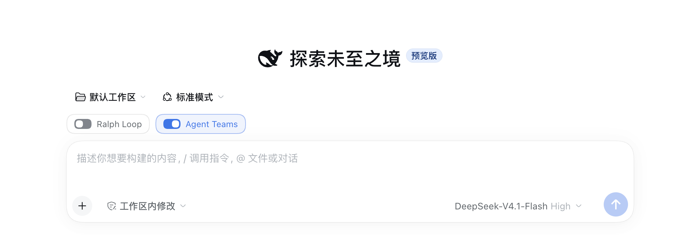

# Enhancement Switches for DeepSeek Harness

[简体中文](README.md) · **English**

> **Does a one-line copy edit need several rounds of Ralph Loop? Does a small fix need a whole Agent Team?**

`dsh-enhancement-switches` adds three independent switches above the DeepSeek Harness message box. Use **Ralph Loop** for repeated testing, **Agent Teams** for parallel work, and **Codex Subagent** to delegate a task to Codex. Each conversation saves its own settings.

**This branch requires DeepSeek Harness `0.2.2-rc.2` or later.** Tested on `0.2.2-rc.2`.

## How to use it



*This screenshot shows the first two switches. Blue means on and gray means off.*

1. **Choose a workspace.** If you're on the blank home screen, choose a workspace to start a conversation. The switches appear above the message box before you send your first message.
2. **Choose what the task needs.** Turn on any combination of switches. All three are off by default in new conversations and independent forks. Reopening a conversation restores its saved settings.
3. **Tell the agent what to do.** The switches make the corresponding tools available in that conversation. Use your message to ask for the workflow you want.

| Switch | When to use it | Example prompt |
| --- | --- | --- |
| **Ralph Loop** | A fix needs repeated attempts and verification, with a fresh agent taking each round | “Use Ralph Loop to fix this issue. Run the tests after each round and stop after at most three rounds.” |
| **Agent Teams** | Several parts of a task can run in parallel with teammates and a shared task board | “Use Agent Teams to review the frontend and backend in parallel, then summarize the findings.” |
| **Codex Subagent** | Codex can handle a self-contained task in the current workspace | “Ask the Codex subagent to review this change for potential regressions.” |

Changing a switch takes no model call. Standard subagent delegation remains available when all three switches are off. Token use depends on the work you delegate. Work already in progress can continue after you turn a switch off. Use Harness's stop control to cancel it.

## Installation

> [!IMPORTANT]
> **Starting with v0.1.3, the official Codex Subagent plugin must be enabled before you can use the Codex conversation switch.** Enhancement Switches reuses the official Codex backend and controls tool availability per conversation.

Configure the Harness Plugins panel as follows:

| Plugin or switch | Setting | Purpose |
| --- | --- | --- |
| Official global Ralph Loop plugin | Disabled | Enhancement Switches provides per-conversation control |
| Built-in Agent Teams | Keep enabled | The input dock and model menu use the same saved conversation setting |
| Official Codex Subagent plugin | Required when using Codex | Provides the Codex backend and manages model, permission, and environment settings |
| Enhancement Switches plugin | Enabled | Adds the three conversation switches |
| Codex switch in a conversation | On or off as needed | Controls whether that conversation can call the Codex subagent |

**The official Codex plugin is not required if you only use the Ralph Loop or Agent Teams switches.** While Enhancement Switches is active, each conversation's switch controls Codex tool availability even when the official Codex plugin is enabled. New conversations default to off.

If you installed a version under an older package name, uninstall it from the corresponding profile first.

### Let Desktop select a compatible version

In **Plugins → Experimental plugins**, enable **Custom plugin indexes**. Open **Discover → Add index source** and enter:

```text
https://raw.githubusercontent.com/lonelycrab888/dsh-enhancement-switches/main/plugin-index.json
```

Select **Enhancement Switches** and install it. Harness recommends the highest version in the index that matches your runtime and installs the Git commit the release tag points to.

### Install a specific version

In **Plugins → Add Plugin**, select the **official npm registry** and paste the appropriate address into **Package name or address**:

| DeepSeek Harness | Enhancement Switches | Git install address |
| --- | --- | --- |
| `>=0.2.2-rc.2` | rc.2 maintenance branch | `git+https://github.com/lonelycrab888/dsh-enhancement-switches.git#v0.2.2-rc.2` |
| `>=0.2.2-rc.2` | [v0.1.6](https://github.com/lonelycrab888/dsh-enhancement-switches/releases/tag/v0.1.6) | `git+https://github.com/lonelycrab888/dsh-enhancement-switches.git#v0.1.6` |
| `0.2.2-rc.1` | [v0.1.3](https://github.com/lonelycrab888/dsh-enhancement-switches/releases/tag/v0.1.3) | `git+https://github.com/lonelycrab888/dsh-enhancement-switches.git#v0.1.3` |

`#main` installs the current commit on the main branch. Use the Discover index to select a compatible version automatically. On rc.2 or later, you can also download the v0.1.6 release archive and enter its absolute path in **Package name or address**.

Restart Desktop if prompted and confirm Enhancement Switches is enabled. Disable the official global Ralph Loop plugin if it is active so the conversation switch controls Ralph.

### Web and local development

For rc.2 or later, install the rc.2 maintenance branch in the Web profile:

```sh
dsh plugin --profile web add 'git+https://github.com/lonelycrab888/dsh-enhancement-switches.git#v0.2.2-rc.2'
dsh web
```

Run these commands from the plugin repository:

```sh
npm ci
npm run build
npm pack
```

For Web, install the package from the same directory:

```sh
dsh plugin --profile web add "$PWD/dsh-enhancement-switches-0.1.6.tgz"
```

### Maintenance and releases

Maintain compatibility on the matching branch. Use [v0.2.2-rc.1](https://github.com/lonelycrab888/dsh-enhancement-switches/tree/v0.2.2-rc.1) for rc.1 and [v0.2.2-rc.2](https://github.com/lonelycrab888/dsh-enhancement-switches/tree/v0.2.2-rc.2) for rc.2. The `main` branch holds ongoing development and the Desktop index.

To release, update the plugin version, run `npm run check`, and commit the version files and generated `lib/`. Create a `vX.Y.Z` tag on that commit matching `package.json`, then push the branch and tag. GitHub Actions reads `engines.dsh` from each tag and updates the plugin index on `main`. To refresh it manually, run **Sync plugin index** from the Actions page.

If GitHub Actions is unavailable, push your branch and run `node scripts/push-release-tag.mjs vX.Y.Z` to push the tag and updated index together.

## Commands and configuration

You can also enter these commands in the message box. Harness updates the conversation settings without a model call.

```text
/agentswitch ralph on
/agentswitch ralph off
/agentswitch teams on
/agentswitch teams off
/agentswitch codex on
/agentswitch codex off
```

Ralph has a default limit of **8 rounds**, and each round may make several model calls. To change the limit, override `maxRounds` in the profile's `cordis.patch.yml`, then reload the plugin or restart Harness.

```yaml
- id: agentswitch
  config:
    maxRounds: 8
```

The input dock and the model and reasoning menu use the same Team setting for the root conversation. With Teams on, the whole subagent tree gets four shared task tools. Use `subagent` or `subagent_fork` to create a member, give it an optional `name`, and message it with `send_message({ agent, message })`. Turning Teams off keeps standard delegation and messaging available. Turning it back on restores the task board.

When a conversation from v0.1.3 is opened, the plugin migrates its saved Teams selection. An existing native selection takes precedence. The host can still read historical experimental Team member records. Remove any profile overrides for the old `agentswitch-team-service` and `agentswitch-team-ui` rows, since the host now supplies the Team service.

With Codex Subagent on, the current root conversation gets the `subagent_codex` tool. Team members and ordinary subagents do not inherit it. Harness starts Codex when it calls the tool, using your local Codex sign-in and configuration. Each call delegates a single task with its instructions and working directory. Sign in to Codex locally before your first call.

The Codex switch reuses the official `codex` provider and existing `subagent_codex` tool. Keep the official plugin enabled. Configure its model, environment, permission mode, and process shutdown settings on the official `subagent-codex` entry. Turning the switch off hides the tool and blocks new calls in that conversation. The official backend continues managing work already started. Disabling or uninstalling Enhancement Switches restores the official tool's global visibility.

To migrate an older configuration, move `agentswitch.config.codexModel` to `subagent-codex.config.model`, remove the old `codexModel` field, and restart Harness. Enabling Codex with the old field present returns migration instructions.

```yaml
- id: subagent-codex
  config:
    model: "<model supported by your Codex account>"
```

For `stage: turn` and `category: product-error`, compare the same task through the official Codex plugin. This official diagnostic category can represent several underlying errors. The switch shares the official backend's diagnostics and binary version.

## Uninstall

Disable or uninstall the plugin from the desktop Plugins panel. For Web CLI, run the following command.

```sh
dsh plugin --profile web remove dsh-enhancement-switches
```

Uninstalling preserves conversation history and saved switch settings. You can re-enable the official global plugins from the Plugins panel.

[MIT License](LICENSE) · [Third-party notices](THIRD_PARTY_NOTICES.md)

## Star History

<a href="https://www.star-history.com/?type=date&repos=lonelycrab888%2Fdsh-enhancement-switches">
 <picture>
   <source media="(prefers-color-scheme: dark)" srcset="https://api.star-history.com/chart?repos=lonelycrab888/dsh-enhancement-switches&type=date&theme=dark&legend=top-left" />
   <source media="(prefers-color-scheme: light)" srcset="https://api.star-history.com/chart?repos=lonelycrab888/dsh-enhancement-switches&type=date&legend=top-left" />
   
 </picture>
</a>

