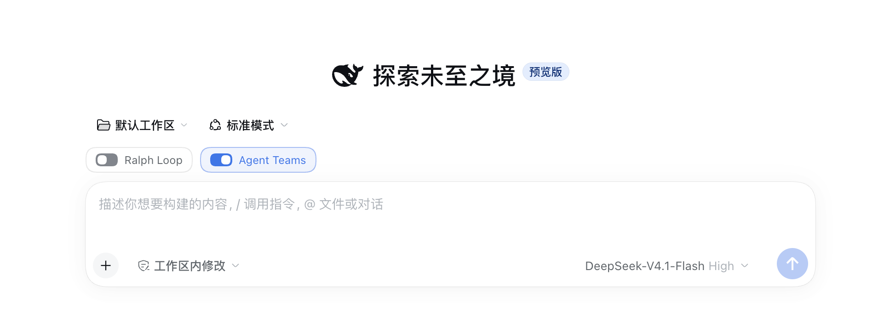

# 增强开关 · dsh-enhancement-switches

**简体中文** · [English](README.en.md)

> **改一行文案，也要让 Ralph Loop 跑上几轮？修个小问题，也要召集整支 Agent Team？**

给 DeepSeek Harness 的对话输入框加上三个独立开关：**Ralph Loop** 用于反复验证，**Agent Teams** 用于团队分工，**Codex Subagent** 用于把一项任务交给 Codex。每个对话单独保存设置。

**已验证版本：DeepSeek Harness `0.2.2-rc.1`** · 桌面端和 Web 可用

## 这样用



*截图展示前两个开关。蓝色表示开启，灰色表示关闭。*

1. **选择工作区。** 打开空白首页时，先选工作区。会话建立后，输入框上方就会显示开关，发第一条消息前就能设置。
2. **按任务打开开关。** 三个开关可以单独开启，也可以同时开启。新对话和独立分叉默认关闭，回到原对话时会恢复之前的选择。
3. **发出具体任务。** 开关只负责让工具在当前对话可用。开启后，在消息里告诉 Agent 你希望它怎么做。

| 开关 | 适合什么时候用 | 可以这样说 |
| --- | --- | --- |
| **Ralph Loop** | 修复需要反复尝试和验证，适合让新 Agent 逐轮接手 | “用 Ralph Loop 修复这个问题，每轮跑测试，最多 3 轮。” |
| **Agent Teams** | 有几项可以并行推进的工作，需要队友和共享任务板 | “用 Agent Teams 并行检查前端和后端，最后汇总发现。” |
| **Codex Subagent** | 希望 Codex 在当前工作区执行一次独立任务 | “让 Codex 子智能体检查这次改动，列出可能的回归。” |

开关操作本身无需调用模型。三个开关都关闭时，插件不会在该会话注册对应的工具和提示词。启用后的 token 用量取决于实际任务。关闭开关前已开始执行的工作可以继续完成。如需中止，请使用 Harness 的停止控制。

## 安装

> [!IMPORTANT]
> **从 v0.1.3 起，使用 Codex 对话开关必须先启用官方 Codex Subagent 插件。** 增强开关复用官方 Codex 后端，按对话控制工具是否可用。

请在 Harness 插件页按下表设置：

| 插件或开关 | 设置 | 作用 |
| --- | --- | --- |
| 官方 Ralph Loop 全局插件 | 关闭 | 由增强开关提供对话级控制 |
| 官方 Agent Teams 全局插件 | 关闭 | 由增强开关提供对话级控制 |
| 官方 Codex Subagent 插件 | 使用 Codex 时必须开启 | 提供 Codex 后端，管理模型、权限和环境配置 |
| 增强开关插件 | 开启 | 在对话界面提供三个开关 |
| 对话中的 Codex 开关 | 按需开启或关闭 | 控制当前对话能否调用 Codex 子智能体 |

**仅使用 Ralph Loop 或 Agent Teams 开关时，不需要启用官方 Codex 插件。** 官方 Codex 插件开启后，只要增强开关插件正在运行，Codex 工具仍由各对话的开关控制；新对话默认关闭。

若装过旧名称的版本，请先在对应 profile 中卸载旧版。

### 桌面端

打开 **插件 → 添加插件**，将 **安装源** 选为 **npm 官方源**，然后把下面的 Git 地址粘贴到 **包名或地址**：

```text
git+https://github.com/lonelycrab888/dsh-enhancement-switches.git#v0.2.2-rc.1
```

如果安装日志显示 GitHub 在下载某个 npm 依赖时返回 404，请检查 **安装源** 是否选成了 GitHub 仓库地址，并切回 **npm 官方源**。Git 地址用于获取插件，npm 源用于下载依赖。

安装完成后，确认官方 Ralph Loop 和 Agent Teams 插件均已关闭，再在插件页启用 **增强开关**。

### Web CLI

直接从 GitHub 安装并启动 Web 端：

```sh
dsh plugin --profile web add 'git+https://github.com/lonelycrab888/dsh-enhancement-switches.git#v0.2.2-rc.1'
dsh web
```

仓库已包含 `lib/` 构建产物，可以直接安装。

## 命令与配置

也可以直接在输入框使用宿主命令。命令会更新会话里的开关状态，无需发给模型：

```text
/agentswitch ralph on
/agentswitch ralph off
/agentswitch teams on
/agentswitch teams off
/agentswitch codex on
/agentswitch codex off
```

Ralph 默认最多 **8 轮**，每轮可能包含多次模型调用。要更改上限，在对应 profile 的 `cordis.patch.yml` 中覆盖以下配置，再重新加载插件或重启宿主：

```yaml
- id: agentswitch
  config:
    maxRounds: 8
```

Team 成员跟随根会话的 Teams 开关。开启时，当前会话和团队成员通过 `spawn_teammate` 直接委派，普通的 `subagent` 和 `subagent_fork` 会从工具列表隐藏。关闭后恢复预设提供的普通委派和控制工具，可用原来的 Agent ID 继续管理切换前创建的普通子智能体。团队任务和成员记录会保留，再开启即可访问。

Codex Subagent 开启后，当前根会话可使用 `subagent_codex`，团队成员和普通子智能体不会继承该工具。Harness 在调用工具时才启动 Codex，沿用本机 Codex 登录与配置。每次调用都是一次独立委派，Codex 收到任务描述和工作目录。首次使用前请在本机登录 Codex。

Codex 开关复用官方的 `codex` provider 和已有的 `subagent_codex` 工具。官方插件需要保持启用，模型、环境变量、审批模式和进程退出设置都由官方 `subagent-codex` 条目管理。开关关闭时，当前会话隐藏该工具并拒绝新调用，已经开始的委派由官方后端继续管理。禁用或卸载增强开关后，官方工具恢复全局可见。

升级旧配置时，请将 `agentswitch.config.codexModel` 移到官方条目的 `config.model`，然后删除旧的 `codexModel` 字段并重启 Harness。保留旧字段时，开启 Codex 会提示迁移，避免静默采用其他模型。

```yaml
- id: subagent-codex
  config:
    model: "<账号支持的 Codex 模型>"
```

如果委派在 `stage: turn` 报 `category: product-error`，请通过官方 Codex 插件做相同任务的对照。该诊断是官方后端返回的分类，可能涵盖多个原始错误。开关复用官方后端的诊断和二进制版本。

## 卸载

桌面端可在插件页禁用或卸载。Web CLI 使用：

```sh
dsh plugin --profile web remove dsh-enhancement-switches
```

卸载后，历史消息和已保存的开关选择会保留。此前关闭的官方全局插件可在插件页手动恢复。

[MIT License](LICENSE) · [第三方代码署名](THIRD_PARTY_NOTICES.md)

## Star History

<a href="https://www.star-history.com/?type=date&repos=lonelycrab888%2Fdsh-enhancement-switches">
 <picture>
   <source media="(prefers-color-scheme: dark)" srcset="https://api.star-history.com/chart?repos=lonelycrab888/dsh-enhancement-switches&type=date&theme=dark&legend=top-left" />
   <source media="(prefers-color-scheme: light)" srcset="https://api.star-history.com/chart?repos=lonelycrab888/dsh-enhancement-switches&type=date&legend=top-left" />
   
 </picture>
</a>
